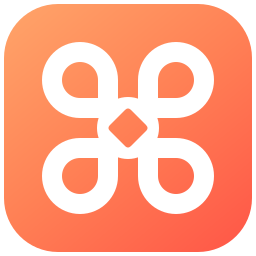
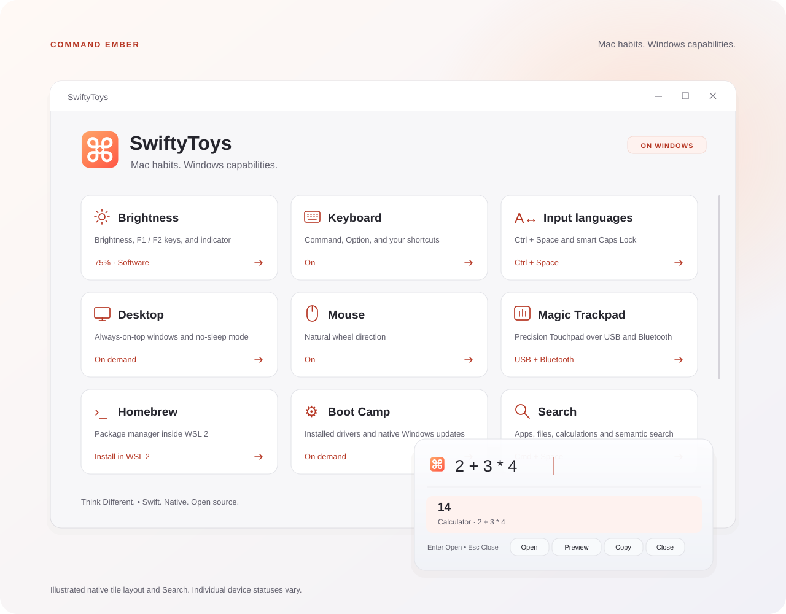

<h1 align="center">SwiftyToys</h1>
<p align="center"></p>
<p align="center">Mac habits. Windows capabilities.</p>
<p align="center">
  <a href="https://github.com/principalwater/SwiftyToys/actions/workflows/build.yml"></a>
  <a href="LICENSE"></a>
  <a href="https://github.com/principalwater/SwiftyToys/releases"></a>
</p>
<p align="center">
  <a href="https://github.com/principalwater/SwiftyToys/releases">Download</a> ·
  <a href="docs/Guide.md">Guide</a> · <a href="CHANGELOG.md">Release notes</a> ·
  <a href="CONTRIBUTING.md">Contribute</a>
</p>

Native **Swift 6.4.1** utilities for Windows, Boot Camp and former macOS users.
Inspired by and complementary to [Microsoft PowerToys](https://github.com/microsoft/PowerToys).
Independent of Microsoft and Apple. Local settings; no telemetry or web renderer.

**Think Different. On Windows.** By [principalwater](https://github.com/principalwater).



## Utilities

| | | |
| --- | --- | --- |
| **[Brightness](docs/Guide.md#features)** — software dimming or DDC/CI; keys, indicator, calibration and recovery | **[Keyboard](docs/Guide.md#features)** — editable Mac shortcuts, application rules and exclusions | **[Input languages](docs/Guide.md#features)** — Ctrl+Space, Caps Lock tap/hold and installed signed Apple RU/EN layouts |
| **[Desktop](docs/Guide.md#features)** — minimize, pin, lock, Sleep and temporary keep-awake | **[Mouse](docs/Guide.md#features)** — native vertical/horizontal wheel direction; no wheel interception | **[Magic Trackpad](docs/Trackpad.md)** — signed Precision drivers, USB/Bluetooth, gestures and recovery |
| **[Homebrew](docs/Guide.md#homebrew)** — WSL 2/Ubuntu setup and the official interactive Linux installer | **[Boot Camp](docs/Guide.md#features)** — installed driver metadata and native Windows update entry points | **[Languages](docs/Localization.md)** — English default, Russian example and extensible UTF-8 packs |
| **[Search](docs/Search.md)** — Cmd+Space, categories, file filters, Quick Keys, calculator, regional conversions, previews and optional local semantic matching | | |

Open a tile to configure it. **Overview** or **Esc** returns to the tiles; drafts,
focus and scroll position survive navigation. Closing settings keeps SwiftyToys active.
Tray Quit restores the output and stops the tools.

## Install

**Windows 10 22H2 / Windows 11 x64.** Download `win-x64-Setup.exe` from
[Releases](https://github.com/principalwater/SwiftyToys/releases), open it and choose
**Install**. Setup installs for your account, configures the Command Ember icon and
starts SwiftyToys. No Swift compiler, Swift DLLs or PowerShell installer is needed.
If the Microsoft Visual C++ Runtime is missing, setup offers its verified official
installer; that separate component requires internet access and administrator consent.

WSL and driver setup request administrator consent separately and may require a restart.
Existing BrightnessCtl settings migrate after safe restoration; its installation remains for rollback. [Installation, CLI and compatibility details](docs/Guide.md).

## Brightness

**Hardware brightness (DDC/CI)** switch:

- **On:** brightness changes the monitor backlight, including the cursor. Requires
  compatible DDC/CI; writes are verified and recovery is retained.
- **Off:** software dims the image; the physical backlight stays unchanged.
  Leaving DDC restores its previous backlight once. Software methods may leave
  native cursors brighter. Native WDDM gamma or AMD color controls preserve the
  original calibration. The copied-desktop renderer is removed after freeze reports;
  existing `compositor` preferences migrate to Automatic without enabling DDC.

Holding F1/F2 repeats brightness using Windows keyboard timing. **Ctrl+Alt+Shift+F10**
requests 100% as an emergency reset.

Supports one independent **physical SDR output**. HDR, clones and virtual outputs
are excluded; fullscreen/calibration software can compete for the output.
[Supported hardware and remaining checks](docs/Requirements.md) · [Validation](docs/Validation.md).

## Mac shortcuts

Edit all shortcuts in Keyboard. **Cmd means the Windows key.**

| Shortcut | Action |
| --- | --- |
| Ctrl+Space | Switch input language |
| Cmd+Tab | Cycle windows while holding Cmd |
| Cmd+H | Minimize; bare Cmd opens Start |
| Cmd+Option+← / → | Browser tabs |
| Cmd+Ctrl+Q | Lock screen |
| Cmd+Ctrl+S | Sleep; preserve wake events and the power plan |
| Cmd+Ctrl+T | Pin/unpin the active window |

The preset includes editing, search, screenshot and Option word-navigation shortcuts.
It replaces the listed Windows meanings, including Win+arrow Snap and Win+Space;
edit/delete rules to restore them. Keep one remapper for the same shortcuts.
Normal-user injection cannot control elevated apps or the secure desktop.
[Input limitations, Apple layouts and trackpad models](docs/Guide.md#features).

## Search

**Cmd+Space** opens a rounded native search bar with the unchanged Mac keyboard preset.
Results expand below it; preview opens on demand. The surrounding Windows Acrylic
surface respects system transparency/high-contrast fallbacks.
Use arrows, Enter, Cmd+C, Space for preview, Cmd+Enter to reveal a file, and Esc to
close. Apps and Windows-indexed content use native Shell/Search APIs, with local
filename fallback. Calculations, units and supported world clocks work offline.
Currency and unit defaults follow Windows regional settings; explicit targets win.
`120 USD` converts to the region's currency using dated Frankfurter reference rates,
with bounded offline caching. Numbers and clocks follow the user's formats.
Web search opens only when selected.

Choose All, Applications, Files or Actions; Cmd+1/2/3 selects a category inside
Search. Use `files: ext:pdf report` or `video: holiday`; Tab opens result actions.
Set exact Quick Keys such as `calc = Calculator` on the Search tile, then type
the alias and press Enter to run the built-in command.

The persistent **Local library** covers local drives with exclusions, pause and
incremental background indexing. It reads text/code, installed document filters,
PDF/OCR and images; optional encoders add audio/video content matching. Initial
indexing takes time and coverage is bounded; ordinary results appear first.
Type and extension filters apply across providers before result limits.

Optional **EmbeddingGemma 2** remains recommended (about 370 MB including runtime;
media encoders add about 535 MB). Text-only **MiniLM** and compatible Hugging Face
models can be selected in settings. Models download separately. Content stays
local; heavy work waits for idle time and yields to Search, input and fullscreen
apps. The model compares meaning; it does not generate answers or exchange rates.
[Scope, licenses and limits](docs/Search.md).

## Build and contribute

Use the official Swift toolchain pinned in [.swift-version](.swift-version), MSVC and Windows SDK.
Package releases with PowerShell 7 for maximum ZIP compression.
Portable BrightnessCore/KeyboardCore/SearchCore tests use Swift Testing; native interop is header-only.

```powershell
./scripts/build.ps1
./scripts/test.ps1
./scripts/package.ps1
./scripts/build-setup.ps1 -PackageDirectory ./artifacts/SwiftyToys-0.1.22-win-x64
```

[Contributor guide](CONTRIBUTING.md) · [Packaging](docs/Packaging.md) ·
[Windows interop](docs/WindowsInterop.md) · [Performance](docs/Performance.md) ·
[Security](SECURITY.md). CI verifies Windows, Linux and macOS core checks. External changes
use reviewed PRs; the maintainer controls merges. Size budgets are 8.5 MB EXE / 3.5 MB ZIP;
performance advantages require reproducible measurements.

The compiler/SDK pin is shared by local scripts and all CI platforms. Follow the
[toolchain upgrade procedure](docs/Toolchain.md) to test a newer stable release;
updates are reviewed and validated before installation or publication.

## Credits and license

[BrightnessCtl 0.5.3](https://github.com/principalwater/BrightnessCtl) display control and
recovery code is integrated directly; its history and MIT copyright are retained.
PowerToys inspired the tool/settings model; Apple inspired the familiar habits.
[MIT](LICENSE) · [Third-party notices](THIRD_PARTY_NOTICES.md).
Proprietary Apple driver/layout binaries are not redistributed.
